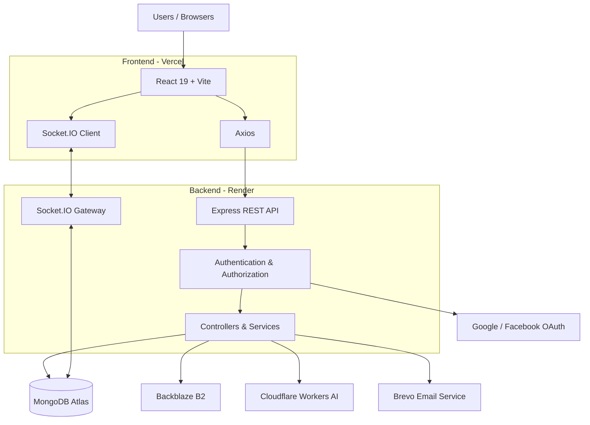

# 🎬 Netflix AI Watch Spaces

### AI-Powered Synchronized Movie Watching & Real-Time Collaboration Platform

<p align="center">
  <strong>Watch Together. Interact Together. Experience Stories Together.</strong>
</p>

<p align="center">
  
  
  
  
  
</p>

<p align="center">
  
  
  
  
</p>

---

## 🌟 About the Project

**Netflix AI Watch Spaces** is a full-stack collaborative movie-watching platform designed to make watching movies with friends more interactive and engaging.

Users can create or join Watch Spaces, watch movies together with synchronized playback, communicate through real-time chat, explore timeline-aware AI insights, participate in trivia, and influence story variations through collaborative voting.

The platform combines the MERN stack, Socket.IO, Cloudflare Workers AI, and S3-compatible media storage to deliver an interactive social movie-watching experience.

> Built as an internship project at **Internmo Pvt. Ltd.**

---

## 🖥️ Live Application

| Component               | URL                                                                              |
| ----------------------- | -------------------------------------------------------------------------------- |
| 🌐 Frontend Application | [Open Application](https://netflix-ai-watch-spaces-three.vercel.app/)            |
| ⚙️ Backend API          | [Backend Server](https://netflix-ai-watch-spaces-8zmq.onrender.com/)             |
| ❤️ API Health Check     | [Check API Health](https://netflix-ai-watch-spaces-8zmq.onrender.com/api/health) |
| 📦 GitHub Repository    | [View Source Code](https://github.com/bari199/netflix-ai-watch-spaces)           |

---

## 🎥 Product Preview

### 🏠 Home Dashboard


### 🎬 Watch Spaces


### 🎞️ Watch Space Details


### 🛠️ Admin Dashboard


---

## ✨ Core Features

### 🎬 Synchronized Watch Spaces

- Create and join collaborative Watch Spaces.
- Host-controlled synchronized playback.
- Play, pause, seek and playback position synchronization.
- Viewer playback drift detection and correction.
- Host disconnect handling and playback state management.
- Manual and automatic playback modes.

### 💬 Real-Time Collaboration

- Live room-based chat.
- Message editing and deletion.
- Emoji reactions.
- Typing indicators.
- Participant presence and online status.
- Real-time room updates through Socket.IO.

### 🤖 AI-Powered Movie Intelligence

- AI-powered movie questions and answers.
- Timeline-aware contextual retrieval.
- Playback-aware question context.
- Source timeline information for relevant answers.
- Cloudflare Workers AI integration.

### 🧠 Interactive Story Experience

- Timeline-based trivia events.
- Manual story variation voting.
- Automatic voting triggered by timeline events.
- Collaborative voting and winner selection.
- Story variation application at the configured playback position.
- Subtitle variants associated with timeline and story variation metadata.

### 🎯 Recommendations & User Interactions

- Personalized content recommendation workflow.
- Watch history and interaction tracking.
- User profile and notification preferences.

### 🛡️ Administration

- Admin authentication and protected routes.
- Title management.
- Video and thumbnail upload workflows.
- Timeline and subtitle metadata management.
- Analytics dashboard.

---

## 🧰 Technology Stack

### Frontend

| Technology       | Purpose                              |
| ---------------- | ------------------------------------ |
| React 19         | Component-based UI                   |
| Vite             | Development server and build tooling |
| Tailwind CSS 4   | Utility-first styling                |
| shadcn/ui        | UI component foundation              |
| Base UI React    | Accessible UI primitives             |
| React Router     | Client-side routing                  |
| Axios            | HTTP requests                        |
| Socket.IO Client | Real-time communication              |
| Lucide React     | Icons                                |
| Motion           | UI animations                        |
| React Hot Toast  | Notifications                        |
| Geist Variable   | Typography                           |

### Backend

| Technology        | Purpose                           |
| ----------------- | --------------------------------- |
| Node.js           | JavaScript runtime                |
| Express 5         | REST API                          |
| Mongoose 9        | MongoDB object modeling           |
| MongoDB           | Application database              |
| Socket.IO         | Real-time event communication     |
| JWT               | Authentication                    |
| Passport.js       | Google and Facebook OAuth         |
| Multer            | Multipart file uploads            |
| AWS SDK v3        | S3-compatible storage integration |
| Helmet            | HTTP security headers             |
| Express Validator | Request validation                |
| Brevo             | Transactional email               |

### AI & Infrastructure

| Technology            | Purpose                            |
| --------------------- | ---------------------------------- |
| Cloudflare Workers AI | AI-powered responses               |
| Backblaze B2          | S3-compatible media object storage |
| Docker                | Local infrastructure               |
| MongoDB Atlas         | Hosted database                    |
| Vercel                | Frontend deployment                |
| Render                | Backend deployment                 |
| Git & GitHub          | Version control                    |

---

## 🏗️ System Architecture



For detailed architecture, data relationships, and communication flows, see the [Architecture Documentation](docs/architecture.md).

---

## 📁 Repository Structure

```text
netflix-ai-watch-spaces/
│
├── 📁 client/                       # React + Vite frontend
│   ├── 📁 public/
│   └── 📁 src/
│       ├── 📁 api/
│       ├── 📁 assets/
│       ├── 📁 components/
│       ├── 📁 context/
│       ├── 📁 hooks/
│       ├── 📁 lib/
│       ├── 📁 pages/
│       ├── 📁 services/
│       ├── 📁 utils/
│       ├── 📄 App.jsx
│       ├── 📄 main.jsx
│       └── 📄 index.css
│
├── 📁 server/                       # Express + Socket.IO backend
│   ├── 📁 src/
│   │   ├── 📁 config/
│   │   ├── 📁 controllers/
│   │   ├── 📁 middleware/
│   │   ├── 📁 models/
│   │   ├── 📁 routes/
│   │   ├── 📁 services/
│   │   ├── 📁 sockets/
│   │   ├── 📄 app.js
│   │   └── 📄 server.js
│   ├── 📁 test/
│   ├── 📁 scripts/
│   └── 📄 package.json
│
├── 📁 docs/                         # Project documentation
│
├── 📁 infra/                        # Docker infrastructure
│   └── 📄 docker.compose.yaml
│
├── 📄 .env.example
├── 📄 .gitignore
└── 📄 README.md
```

_This is a high-level project structure overview, not an exhaustive listing of every repository file._

---

## 📚 Documentation

Explore the technical documentation for a deeper understanding of the project.

| Documentation                                                                       | Description                                                            |
| ----------------------------------------------------------------------------------- | ---------------------------------------------------------------------- |
| [📖 API Reference](docs/api-reference.md)                                           | REST API endpoints, methods, authentication and request workflows      |
| [🏗️ Architecture](docs/architecture.md)                                             | System architecture, components and application data flows             |
| [🗄️ Database Schema](docs/database-schema.md)                                       | MongoDB collections, Mongoose models and relationships                 |
| [🚀 Deployment Guide](docs/deployment-guide.md)                                     | Production deployment architecture and configuration                   |
| [⚙️ Setup Guide](docs/setup-guide.md)                                               | Local development environment and installation instructions            |
| [🔌 Socket Events](docs/socket-events.md)                                           | Socket.IO events, real-time communication and playback synchronization |
| [🧪 Testing & Performance](docs/testing-and-performance.md)                         | Testing coverage, performance targets and validation                   |
| [⚠️ Known Limitations & Retrospective](docs/known-limitations-and-retrospective.md) | Technical considerations, limitations and future improvements          |
| [📋 Remaining Work Checklist](docs/netflix-ai-watch-spaces-remaining-work.txt)      | Project tracking and remaining work                                    |

---

## ⚙️ Getting Started

Follow these steps to run the project locally.

### 1. Prerequisites

Install the following:

- Node.js and npm
- Git
- Docker Desktop or Docker Engine
- MongoDB
- VS Code (recommended)

External credentials are required for enabled integrations such as Backblaze B2, Cloudflare Workers AI, Brevo, and OAuth providers.

### 2. Clone the Repository

```bash
git clone https://github.com/bari199/netflix-ai-watch-spaces.git

cd netflix-ai-watch-spaces
```

### 3. Configure Environment Variables

Create a root `.env` file using the example:

```bash
cp .env.example .env
```

On Windows PowerShell:

```powershell
Copy-Item .env.example .env
```

Configure the required credentials and settings.

Important backend configuration includes:

```env
MONGODB_URI=

ACCESS_TOKEN_SECRET=
REFRESH_TOKEN_SECRET=

B2_ENDPOINT=
B2_REGION=
B2_BUCKET_NAME=
B2_APPLICATION_KEY_ID=
B2_APPLICATION_KEY=

CLOUDFLARE_ACCOUNT_ID=
CLOUDFLARE_API_TOKEN=
CLOUDFLARE_AI_MODEL=

CLIENT_URL=
PORT=5000
```

Also configure the required Google and Facebook OAuth callback credentials and Brevo settings where applicable.

Never commit real credentials or API keys.

### 4. Start MongoDB

From the repository root:

```bash
docker compose -f infra/docker.compose.yaml up -d mongodb
```

Check the container:

```bash
docker compose -f infra/docker.compose.yaml ps
```

The current local Compose configuration exposes MongoDB on:

```text
mongodb://127.0.0.1:27018/netflix_ai_watch_spaces
```

### 5. Install and Run Backend

Open a terminal:

```bash
cd server

npm install

npm run dev
```

Backend development server:

```text
http://localhost:5000
```

Health check:

```text
http://localhost:5000/api/health
```

### 6. Install and Run Frontend

Open another terminal:

```bash
cd client

npm install

npm run dev
```

Frontend development server:

```text
http://localhost:5173
```

For detailed environment configuration and troubleshooting, read the [Setup Guide](docs/setup-guide.md).

---

## 🧪 Testing

The backend uses Node.js's built-in test runner.

Run backend tests:

```bash
cd server

npm test
```

Evaluate recommendations:

```bash
npm run evaluate:recommendations
```

Frontend production build:

```bash
cd client

npm run build
```

Frontend lint:

```bash
npm run lint
```

Functional testing and validation have been completed as reported during project development. See [Testing and Performance](docs/testing-and-performance.md) for the testing inventory and indicative performance targets.

---

## 🚀 Deployment

The current production application uses the following deployment services:

| Layer             | Platform / Service    |
| ----------------- | --------------------- |
| Frontend          | Vercel                |
| Backend API       | Render                |
| Real-Time Gateway | Socket.IO on Render   |
| Database          | MongoDB Atlas         |
| Media Storage     | Backblaze B2          |
| AI Inference      | Cloudflare Workers AI |
| Email             | Brevo                 |

Production URLs:

- Frontend: https://netflix-ai-watch-spaces-three.vercel.app/
- Backend: https://netflix-ai-watch-spaces-8zmq.onrender.com/
- Health: https://netflix-ai-watch-spaces-8zmq.onrender.com/api/health

See the [Deployment Guide](docs/deployment-guide.md) for deployment configuration and verification details.

---

## 🔐 Security Considerations

- JWT-based authentication.
- Access-token and refresh-token session handling.
- HTTP-only refresh cookie workflow.
- Protected user and admin routes.
- Role-based authorization.
- Password hashing.
- Express security middleware.
- Credential and environment-variable separation.
- Authenticated Socket.IO connections.

Keep production secrets outside the repository and configure allowed frontend origins carefully.

---

## 🎯 Project Objectives

The project focuses on combining full-stack development with real-time and AI-powered capabilities.

Key engineering objectives:

- Build a collaborative movie-watching experience.
- Implement host-authoritative synchronized playback.
- Develop real-time communication using Socket.IO.
- Integrate contextual AI responses with timeline metadata.
- Implement interactive trivia and collaborative story voting.
- Build reusable REST API and database modules.
- Deploy a multi-service full-stack application.

---

## 👨‍💻 Internship & Development

**Internship Organization:** Internmo Pvt. Ltd.

**Project:** Netflix AI Watch Spaces

This project was developed as part of an internship at Internmo Pvt. Ltd., providing practical experience in full-stack application development, REST API design, database integration, real-time systems, AI service integration, testing, and deployment.

---

## 🤝 Contributing

Contributions, suggestions, and improvements are welcome.

1. Fork the repository.
2. Create a feature branch in your fork.
3. Make your changes.
4. Test your changes.
5. Submit a Pull Request with a clear description.

---

## 📄 License

The backend package currently declares the ISC license.

Review the licensing requirements for third-party libraries, movie assets, images, and other media separately before redistribution or public commercial use.

---

<p align="center">
  <strong>Netflix AI Watch Spaces</strong>
  <br />
  Built with ❤️ using the MERN Stack, Socket.IO and Cloudflare Workers AI.
</p>
