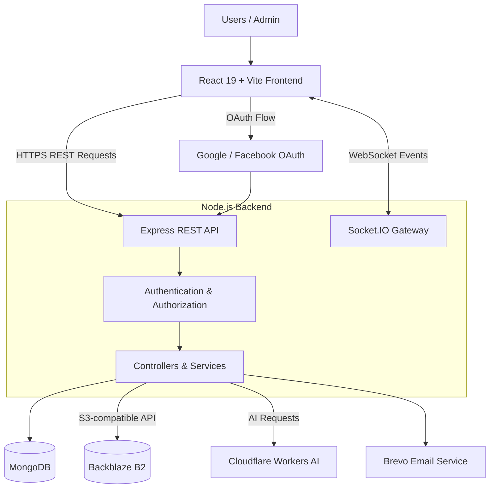

# Netflix AI Watch Spaces — System Architecture

## Technology Stack

## 1. System Overview

Netflix AI Watch Spaces is a JavaScript-based MERN application that enables users to watch movies together in synchronized virtual Watch Spaces.

The system combines:

- React-based frontend for the user interface.
- Express REST API for application operations.
- Socket.IO for real-time communication and synchronized playback.
- MongoDB for persistent application data.
- Backblaze B2 for S3-compatible media object storage.
- Cloudflare Workers AI for AI-powered question answering.
- Brevo for transactional email delivery.
- Google and Facebook OAuth for social authentication.

## 2. High-Level Architecture

## 3. Runtime Components

### Frontend

**Technologies:**

- React 19
- Vite
- React Router
- Axios
- Tailwind CSS 4
- shadcn-style UI components
- Socket.IO Client

**Responsibilities:**

- User registration and authentication.
- Browse and discover movie titles.
- Create, join and manage Watch Spaces.
- Display synchronized movie playback.
- Real-time group chat and participant updates.
- Voting, trivia and interactive viewing features.
- AI Co-Pilot interface.

### Backend

**Technologies:**

- Node.js
- Express.js 5
- JavaScript ES Modules
- Mongoose 9
- Socket.IO 4

**Responsibilities:**

- REST API endpoints.
- JWT authentication and authorization.
- Watch Space lifecycle management.
- Host and participant permissions.
- Playback synchronization.
- Real-time chat and voting.
- Media upload and streaming.
- AI request processing.

### Database

**Technology:** MongoDB

MongoDB stores application data, including:

- Users and authentication information.
- Movie titles and metadata.
- Watch Spaces and participants.
- Chat messages.
- Viewing interactions and progress.
- Voting and session-related data.

Mongoose is used for schema definition, validation and database operations.

### Object Storage

**Provider:** Backblaze B2

**Integration:** AWS SDK for JavaScript v3 (S3-compatible API)

Backblaze B2 stores media assets separately from the application database.

Stored assets include:

- Movie video files.
- Movie thumbnails.
- Subtitle files.
- User avatar images.

The backend uses B2 bucket configuration and S3-compatible credentials to access stored objects.

MongoDB stores the associated metadata and object references rather than the actual video file contents.

### AI Service

**Provider:** Cloudflare Workers AI

The AI Co-Pilot provides contextual question answering using movie timeline and playback-related metadata.

Main responsibilities:

- Retrieve relevant timeline events.
- Process user questions.
- Generate AI responses using Cloudflare Workers AI.
- Return relevant source timeline information.

### Authentication and Email

- JWT access and refresh token authentication.
- HTTP-only refresh-token cookies.
- Google OAuth using Passport.
- Facebook OAuth using Passport.
- Brevo for transactional emails.

## 4. Core Application Flows

### 4.1 Authentication Flow

1. User registers or logs in through the frontend.
2. The frontend sends the request to the Express API.
3. The backend validates credentials.
4. The backend issues an access token and refresh-token cookie.
5. Protected requests use Bearer authentication.
6. Refresh-token rotation maintains the session.

### 4.2 Watch Space Flow

1. A host creates a Watch Space.
2. The backend validates the user and selected title.
3. The Watch Space is stored in MongoDB.
4. Participants join through the Watch Space API.
5. Socket.IO authenticates connected users.
6. Authorized participants join the corresponding Socket.IO room.
7. Real-time events distribute playback, chat, voting and participant updates.

### 4.3 Media Flow

1. An authorized administrator uploads a movie or related asset.
2. The backend processes the upload.
3. The media object is stored in Backblaze B2 through the S3-compatible API.
4. MongoDB stores the associated title metadata and object references.
5. The frontend requests media through backend endpoints.
6. The backend retrieves and streams the requested media from B2.

### 4.4 AI Co-Pilot Flow

1. A participant submits a question.
2. The backend receives the question.
3. The retrieval service searches relevant timeline metadata.
4. Relevant context is sent to Cloudflare Workers AI.
5. The generated response is returned with relevant timeline source information.
6. The frontend displays the answer.

## 5. Data Relationships

- A **User** can host or participate in multiple Watch Spaces.
- A **Title** can be associated with multiple Watch Spaces.
- A **WatchSpace** references one Title and one Host.
- A **WatchSpace** contains participant, playback, voting and session information.
- A **ChatMessage** references a Watch Space and its sender.
- An **Interaction** references a User and a Title and stores viewing progress or rating.

See [Database Schema](database-schema.md) for detailed model relationships.

## 6. Deployment Architecture

The application uses separate frontend and backend deployments.

| Component               | Hosting / Service     |
| ----------------------- | --------------------- |
| Frontend                | Vercel                |
| Backend REST API        | Render                |
| Socket.IO               | Render backend        |
| Database                | MongoDB               |
| Video and media storage | Backblaze B2          |
| AI inference            | Cloudflare Workers AI |
| Transactional email     | Brevo                 |

### Production URLs

- Frontend: https://netflix-ai-watch-spaces-three.vercel.app
- Backend API: https://netflix-ai-watch-spaces-8zmq.onrender.com
- API Base URL: https://netflix-ai-watch-spaces-8zmq.onrender.com/api

The frontend communicates with the deployed backend through HTTPS and Socket.IO connections.

## 7. Security Architecture

- Protected REST endpoints use JWT Bearer authentication.
- Refresh tokens are stored in HTTP-only cookies.
- Refresh tokens are hashed before database storage.
- Socket.IO authenticates connections using JWT.
- Watch Space membership and host permissions are checked for protected room operations.
- Admin-only operations use role-based authorization.
- Backblaze B2 credentials are stored in environment variables.
- Cloudflare and OAuth credentials must never be committed to Git.
- Production CORS must allow the exact frontend origin.
- Credentialed requests must not use wildcard CORS origins.

## 8. Operational Notes

- Health endpoint: `GET /api/health`.
- Socket.IO shares the backend HTTP server.
- MongoDB connection is initialized during backend startup.
- Backend startup also checks the configured Backblaze B2 bucket.
- Media objects are accessed through the S3-compatible Backblaze B2 endpoint.
- Production secrets must be configured through the hosting environment.

See [Setup Guide](setup-guide.md) for installation and environment configuration.
