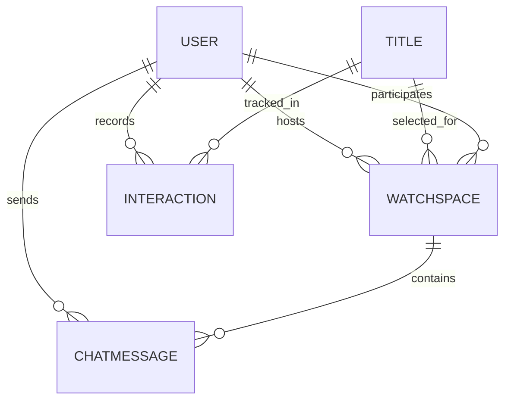

# Database Schema

Describes the Mongoose models currently present in `server/src/models`.

## User

Collection model: `User`.

| Field | Purpose |
|---|---|
| name, email | Display name and unique normalized email |
| password | Local password hash; excluded from default queries |
| avatar | MinIO object key or OAuth avatar URL depending on registration flow |
| role | `viewer`, `host` or `admin` |
| refreshTokenHash, refreshTokenExpiresAt | Hashed refresh-token session state; excluded by default |
| isEmailVerified, welcomeEmailSentAt | Email lifecycle |
| emailVerificationTokenHash, emailVerificationExpiresAt | Email verification state; excluded by default |
| passwordResetOtpHash, passwordResetOtpExpiresAt, passwordResetOtpAttempts | Password reset state; excluded by default |
| notificationPreferences | soundEnabled and vibrationEnabled |
| authProvider, googleId, facebookId | Local/Google/Facebook identity |

Timestamps are enabled. Passwords are hashed with bcryptjs before save.

## Title

Core fields: name, description, genre, releaseYear, duration, videoKey, thumbnailKey, timeline, subtitleVariants, isPublished and createdBy.

Timeline event types: `scene`, `characterAppearance`, `trivia`, `glossary`, `variationPoint`. Events can contain eventId, startTime, endTime, text, description, question, transcript, trivia, character metadata, variationId and option records.

Subtitle variants contain variantId, locale, label, storageKey and optional eventId, variationId and optionId references.

Indexes: text index on name/description and index on isPublished.

## WatchSpace

| Field group | Contents |
|---|---|
| title, host | References to Title and User |
| participants | User reference, role, joinedAt and isMuted |
| playback | state, positionSeconds, updatedAt and updatedBy |
| playbackMode | manual or automatic |
| limits/settings | maxParticipants, aiVerbosity, triviaEnabled, votingEnabled |
| timeline state | triggeredTriviaEventIds, triggeredVariationEventIds |
| activeVote | variationId, question, eventId, mode, options, status, durationSeconds, closesAt, applyAtSeconds, votes, winningOptionId, appliedAt and triggeredBy |
| lifecycle | status, startedAt, endedAt, scheduledAt |
| analytics | peakParticipants and aiQuestionsAsked |
| access | isPrivate, isLocked and inviteCode |

Status values: scheduled, waiting, active and ended. Timestamps are enabled.

## ChatMessage

Fields: watchSpace, sender, message (trimmed, max 2000 characters), reactions (user and emoji) and editedAt. Timestamps are enabled. Indexes support Watch Space lookup and chronological message access.

## Interaction

Fields: user, title, optional watchSpace, watchDurationSeconds, lastPositionSeconds, completionPercentage, isCompleted, rating and lastWatchedAt. Timestamps are enabled.

Indexes: unique compound index on user+title; user+lastWatchedAt; title+completionPercentage.

## Relationship overview

This is a model-level schema reference, not a live database export. Confirm actual deployed indexes and data separately.
