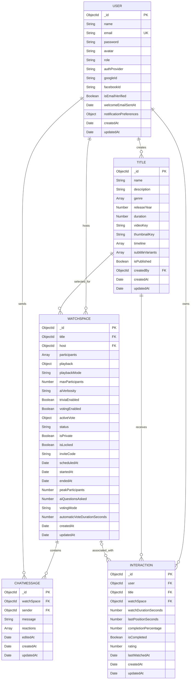
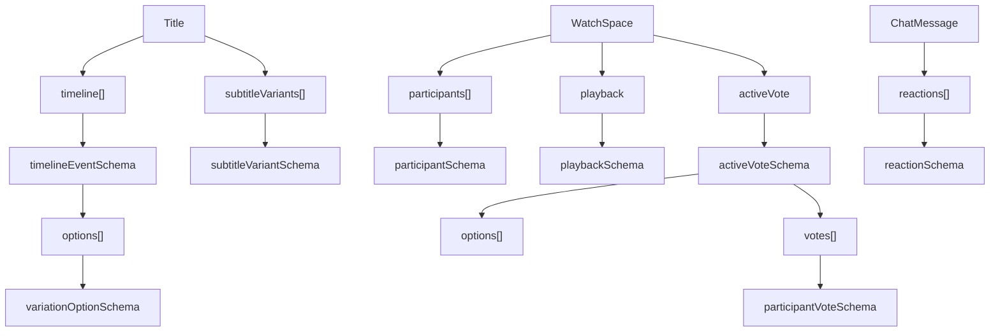

# Database Schema — Netflix AI Watch Spaces

This document describes the MongoDB data models implemented in the Netflix AI Watch Spaces backend using Mongoose.

> **Schema source:** `server/src/models/`

## 1. Database Collections

The backend defines the following five Mongoose models:

| Collection / Model | Source File      | Purpose                                                    |
| ------------------ | ---------------- | ---------------------------------------------------------- |
| **User**           | `User.js`        | User identity, authentication and notification preferences |
| **Title**          | `Title.js`       | Movie metadata, timeline events and subtitle variants      |
| **WatchSpace**     | `WatchSpace.js`  | Watch sessions, participants, playback and voting state    |
| **ChatMessage**    | `ChatMessage.js` | Watch Space messages and reactions                         |
| **Interaction**    | `Interaction.js` | User viewing progress, completion and rating               |

## 2. Entity Relationship Diagram

The following diagram represents the actual ObjectId references defined in the Mongoose schemas.

**Relationship notation**

- `PK` — MongoDB document identifier (`_id`).
- `FK` — Mongoose ObjectId reference (`ref`).
- `UK` — Unique field constraint.
- Embedded arrays and objects remain inside their parent document.

## 3. Collection Schemas

### 3.1 User

**Model:** `User`

**Source:** `server/src/models/User.js`

Stores user identity, authentication information, account verification state and notification preferences.

| Field                                      | Type     | Constraints / Default                                 |
| ------------------------------------------ | -------- | ----------------------------------------------------- |
| `_id`                                      | ObjectId | MongoDB document identifier                           |
| `name`                                     | String   | Required, trimmed                                     |
| `email`                                    | String   | Required, unique, lowercase, trimmed                  |
| `password`                                 | String   | Excluded from default query selection                 |
| `avatar`                                   | String   | Default: `""`                                         |
| `role`                                     | String   | Enum: `viewer`, `host`, `admin`; default: `viewer`    |
| `refreshTokenHash`                         | String   | Default: `null`, excluded from default selection      |
| `refreshTokenExpiresAt`                    | Date     | Default: `null`, excluded from default selection      |
| `isEmailVerified`                          | Boolean  | Default: `false`                                      |
| `welcomeEmailSentAt`                       | Date     | Default: `null`                                       |
| `emailVerificationTokenHash`               | String   | Default: `null`, excluded from default selection      |
| `emailVerificationExpiresAt`               | Date     | Default: `null`, excluded from default selection      |
| `notificationPreferences.soundEnabled`     | Boolean  | Default: `true`                                       |
| `notificationPreferences.vibrationEnabled` | Boolean  | Default: `true`                                       |
| `passwordResetOtpHash`                     | String   | Default: `null`, excluded from default selection      |
| `passwordResetOtpExpiresAt`                | Date     | Default: `null`, excluded from default selection      |
| `passwordResetOtpAttempts`                 | Number   | Default: `0`, excluded from default selection         |
| `authProvider`                             | String   | Enum: `local`, `google`, `facebook`; default: `local` |
| `googleId`                                 | String   | Sparse index                                          |
| `facebookId`                               | String   | Sparse index                                          |
| `createdAt`                                | Date     | Mongoose timestamp                                    |
| `updatedAt`                                | Date     | Mongoose timestamp                                    |

**Schema behavior**

- Passwords are hashed using `bcryptjs` with 12 salt rounds before saving.
- `comparePassword()` compares a candidate password against the stored hash.
- Mongoose timestamps automatically maintain `createdAt` and `updatedAt`.

### 3.2 Title

**Model:** `Title`

**Source:** `server/src/models/Title.js`

Stores movie metadata, video object references, timeline events and subtitle variants.

| Field              | Type            | Constraints / Default                           |
| ------------------ | --------------- | ----------------------------------------------- |
| `_id`              | ObjectId        | MongoDB document identifier                     |
| `name`             | String          | Required, trimmed                               |
| `description`      | String          | Default: `""`, trimmed                          |
| `genre`            | Array of String | Each item trimmed                               |
| `releaseYear`      | Number          | Minimum: `1888`                                 |
| `duration`         | Number          | Required, minimum: `1`                          |
| `videoKey`         | String          | Required, trimmed                               |
| `thumbnailKey`     | String          | Default: `""`                                   |
| `timeline`         | Array           | Embedded `timelineEventSchema`; default: `[]`   |
| `subtitleVariants` | Array           | Embedded `subtitleVariantSchema`; default: `[]` |
| `isPublished`      | Boolean         | Default: `false`                                |
| `createdBy`        | ObjectId        | Reference: `User`; required                     |
| `createdAt`        | Date            | Mongoose timestamp                              |
| `updatedAt`        | Date            | Mongoose timestamp                              |

#### Embedded Schema: Timeline Event

Each `timeline` item uses `timelineEventSchema`.

| Field           | Type            | Constraints / Default                           |
| --------------- | --------------- | ----------------------------------------------- |
| `eventId`       | String          | Required, trimmed                               |
| `text`          | String          | Trimmed                                         |
| `startTime`     | Number          | Required, minimum: `0`                          |
| `endTime`       | Number          | Required, minimum: `0`                          |
| `eventType`     | String          | Required; enum listed below                     |
| `description`   | String          | Trimmed                                         |
| `question`      | String          | Default: `""`, trimmed                          |
| `transcript`    | String          | Default: `""`                                   |
| `trivia`        | Array of String | Each item trimmed                               |
| `characterId`   | String          | Trimmed                                         |
| `characterName` | String          | Trimmed                                         |
| `variationId`   | String          | Default: `null`, trimmed                        |
| `options`       | Array           | Embedded `variationOptionSchema`; default: `[]` |

**Timeline event types**

- `scene`
- `characterAppearance`
- `trivia`
- `glossary`
- `variationPoint`

#### Embedded Schema: Variation Option

Each `options` item inside a timeline event uses `variationOptionSchema`.

| Field   | Type   | Constraints       |
| ------- | ------ | ----------------- |
| `id`    | String | Required, trimmed |
| `label` | String | Required, trimmed |

`variationOptionSchema` uses `{ _id: false }`.

#### Embedded Schema: Subtitle Variant

Each `subtitleVariants` item uses `subtitleVariantSchema`.

| Field         | Type   | Constraints / Default    |
| ------------- | ------ | ------------------------ |
| `variantId`   | String | Required, trimmed        |
| `locale`      | String | Required, trimmed        |
| `label`       | String | Required, trimmed        |
| `storageKey`  | String | Required, trimmed        |
| `eventId`     | String | Default: `null`, trimmed |
| `variationId` | String | Default: `null`, trimmed |
| `optionId`    | String | Default: `null`, trimmed |

**Indexes**

| Index                                   | Type            |
| --------------------------------------- | --------------- |
| `{ name: "text", description: "text" }` | Text index      |
| `{ isPublished: 1 }`                    | Ascending index |

### 3.3 WatchSpace

**Model:** `WatchSpace`

**Source:** `server/src/models/WatchSpace.js`

Stores Watch Space sessions, host and participant information, playback state, voting configuration and session status.

| Field                          | Type            | Constraints / Default                                               |
| ------------------------------ | --------------- | ------------------------------------------------------------------- |
| `_id`                          | ObjectId        | MongoDB document identifier                                         |
| `title`                        | ObjectId        | Reference: `Title`; required                                        |
| `host`                         | ObjectId        | Reference: `User`; required                                         |
| `participants`                 | Array           | Embedded `participantSchema`; default: `[]`                         |
| `playback`                     | Object          | Embedded `playbackSchema`; default: `{}`                            |
| `playbackMode`                 | String          | Enum: `manual`, `automatic`; default: `manual`                      |
| `maxParticipants`              | Number          | Default: `50`, minimum: `2`, maximum: `50`                          |
| `aiVerbosity`                  | String          | Enum: `minimal`, `normal`, `chatty`; default: `normal`              |
| `triviaEnabled`                | Boolean         | Default: `true`                                                     |
| `triggeredTriviaEventIds`      | Array of String | Default: `[]`                                                       |
| `triggeredVariationEventIds`   | Array of String | Default: `[]`                                                       |
| `votingEnabled`                | Boolean         | Default: `true`                                                     |
| `activeVote`                   | Object          | Embedded `activeVoteSchema`; default: `null`                        |
| `status`                       | String          | Enum: `scheduled`, `waiting`, `active`, `ended`; default: `waiting` |
| `startedAt`                    | Date            | Default: `null`                                                     |
| `endedAt`                      | Date            | Default: `null`                                                     |
| `peakParticipants`             | Number          | Default: `0`, minimum: `0`                                          |
| `aiQuestionsAsked`             | Number          | Default: `0`, minimum: `0`                                          |
| `scheduledAt`                  | Date            | Default: `null`                                                     |
| `votingMode`                   | String          | Enum: `manual`, `automatic`; default: `manual`                      |
| `automaticVoteDurationSeconds` | Number          | Default: `60`, minimum: `5`, maximum: `120`                         |
| `triggeredVariationVoteIds`    | Array of String | Default: `[]`                                                       |
| `isPrivate`                    | Boolean         | Default: `false`                                                    |
| `isLocked`                     | Boolean         | Default: `false`                                                    |
| `inviteCode`                   | String          | Default: `null`                                                     |
| `createdAt`                    | Date            | Mongoose timestamp                                                  |
| `updatedAt`                    | Date            | Mongoose timestamp                                                  |

#### Embedded Schema: Participant

Each `participants` item uses `participantSchema`.

| Field      | Type     | Constraints / Default                     |
| ---------- | -------- | ----------------------------------------- |
| `user`     | ObjectId | Reference: `User`; required               |
| `role`     | String   | Enum: `host`, `viewer`; default: `viewer` |
| `joinedAt` | Date     | Default: `Date.now`                       |
| `isMuted`  | Boolean  | Default: `false`                          |

`participantSchema` uses `{ _id: false }`.

#### Embedded Schema: Playback

The `playback` object uses `playbackSchema`.

| Field             | Type     | Constraints / Default                                                |
| ----------------- | -------- | -------------------------------------------------------------------- |
| `state`           | String   | Enum: `playing`, `paused`, `seeking`, `buffering`; default: `paused` |
| `positionSeconds` | Number   | Default: `0`, minimum: `0`                                           |
| `updatedAt`       | Date     | Default: `Date.now`                                                  |
| `updatedBy`       | ObjectId | Reference: `User`; default: `null`                                   |

`playbackSchema` uses `{ _id: false }`.

#### Embedded Schema: Active Vote

The `activeVote` object uses `activeVoteSchema`.

| Field             | Type     | Constraints / Default                              |
| ----------------- | -------- | -------------------------------------------------- |
| `variationId`     | String   | Required, trimmed                                  |
| `question`        | String   | Default: `""`, trimmed                             |
| `eventId`         | String   | Default: `null`, trimmed                           |
| `mode`            | String   | Enum: `manual`, `automatic`; default: `manual`     |
| `options`         | Array    | Embedded vote option objects                       |
| `status`          | String   | Enum: `open`, `closed`, `applied`; default: `open` |
| `durationSeconds` | Number   | Required, minimum: `1`                             |
| `closesAt`        | Date     | Required                                           |
| `applyAtSeconds`  | Number   | Required, minimum: `0`                             |
| `votes`           | Array    | Embedded `participantVoteSchema`; default: `[]`    |
| `winningOptionId` | String   | Default: `null`                                    |
| `appliedAt`       | Date     | Default: `null`                                    |
| `triggeredBy`     | ObjectId | Reference: `User`; required                        |

**Active vote option fields**

| Field   | Type   | Constraints       |
| ------- | ------ | ----------------- |
| `id`    | String | Required, trimmed |
| `label` | String | Required, trimmed |

Active vote option objects disable their own `_id` field.

#### Embedded Schema: Participant Vote

Each `votes` item uses `participantVoteSchema`.

| Field      | Type     | Constraints / Default       |
| ---------- | -------- | --------------------------- |
| `user`     | ObjectId | Reference: `User`; required |
| `optionId` | String   | Required, trimmed           |
| `votedAt`  | Date     | Default: `Date.now`         |

`participantVoteSchema` uses `{ _id: false }`.

### 3.4 ChatMessage

**Model:** `ChatMessage`

**Source:** `server/src/models/ChatMessage.js`

Stores messages sent inside Watch Spaces and their emoji reactions.

| Field        | Type     | Constraints / Default                      |
| ------------ | -------- | ------------------------------------------ |
| `_id`        | ObjectId | MongoDB document identifier                |
| `watchSpace` | ObjectId | Reference: `WatchSpace`; required, indexed |
| `sender`     | ObjectId | Reference: `User`; required                |
| `message`    | String   | Required, trimmed, maximum length: `2000`  |
| `reactions`  | Array    | Embedded `reactionSchema`; default: `[]`   |
| `editedAt`   | Date     | Default: `null`                            |
| `createdAt`  | Date     | Mongoose timestamp                         |
| `updatedAt`  | Date     | Mongoose timestamp                         |

#### Embedded Schema: Reaction

Each `reactions` item uses `reactionSchema`.

| Field   | Type     | Constraints                 |
| ------- | -------- | --------------------------- |
| `user`  | ObjectId | Reference: `User`; required |
| `emoji` | String   | Required                    |

`reactionSchema` uses `{ _id: false }`.

**Indexes**

| Index                              | Type           |
| ---------------------------------- | -------------- |
| `{ watchSpace: 1 }`                | Field index    |
| `{ watchSpace: 1, createdAt: -1 }` | Compound index |

### 3.5 Interaction

**Model:** `Interaction`

**Source:** `server/src/models/Interaction.js`

Stores a user's viewing progress, completion state and rating for a title.

| Field                  | Type     | Constraints / Default                       |
| ---------------------- | -------- | ------------------------------------------- |
| `_id`                  | ObjectId | MongoDB document identifier                 |
| `user`                 | ObjectId | Reference: `User`; required                 |
| `title`                | ObjectId | Reference: `Title`; required                |
| `watchSpace`           | ObjectId | Reference: `WatchSpace`; default: `null`    |
| `watchDurationSeconds` | Number   | Default: `0`, minimum: `0`                  |
| `lastPositionSeconds`  | Number   | Default: `0`, minimum: `0`                  |
| `completionPercentage` | Number   | Default: `0`, minimum: `0`, maximum: `100`  |
| `isCompleted`          | Boolean  | Default: `false`                            |
| `rating`               | Number   | Minimum: `1`, maximum: `5`, default: `null` |
| `lastWatchedAt`        | Date     | Default: `Date.now`                         |
| `createdAt`            | Date     | Mongoose timestamp                          |
| `updatedAt`            | Date     | Mongoose timestamp                          |

**Indexes**

| Index                                    | Type                  |
| ---------------------------------------- | --------------------- |
| `{ user: 1, title: 1 }`                  | Unique compound index |
| `{ user: 1, lastWatchedAt: -1 }`         | Compound index        |
| `{ title: 1, completionPercentage: -1 }` | Compound index        |

The unique compound index ensures one Interaction document per user and title combination.

## 4. Embedded Schema Structure

The following diagram shows how embedded documents are organized inside their parent collections.

## 5. ObjectId Reference Summary

The following table lists only the references declared in the model schemas.

| Source Model                       | Field         | Referenced Model |
| ---------------------------------- | ------------- | ---------------- |
| `Title`                            | `createdBy`   | `User`           |
| `WatchSpace`                       | `title`       | `Title`          |
| `WatchSpace`                       | `host`        | `User`           |
| `WatchSpace.participantSchema`     | `user`        | `User`           |
| `WatchSpace.playbackSchema`        | `updatedBy`   | `User`           |
| `WatchSpace.activeVoteSchema`      | `triggeredBy` | `User`           |
| `WatchSpace.participantVoteSchema` | `user`        | `User`           |
| `ChatMessage`                      | `watchSpace`  | `WatchSpace`     |
| `ChatMessage`                      | `sender`      | `User`           |
| `ChatMessage.reactionSchema`       | `user`        | `User`           |
| `Interaction`                      | `user`        | `User`           |
| `Interaction`                      | `title`       | `Title`          |
| `Interaction`                      | `watchSpace`  | `WatchSpace`     |

## 6. Schema Configuration

| Model       | Mongoose Timestamps |
| ----------- | ------------------- |
| User        | Enabled             |
| Title       | Enabled             |
| WatchSpace  | Enabled             |
| ChatMessage | Enabled             |
| Interaction | Enabled             |

Embedded schemas with `{ _id: false }`:

- `variationOptionSchema`
- `timelineEventSchema`
- `subtitleVariantSchema`
- `participantSchema`
- `playbackSchema`
- `participantVoteSchema`
- `activeVoteSchema`
- `reactionSchema`

## 7. Source Files

All schema definitions are maintained in the backend model directory:

[`server/src/models/`](../server/src/models/)

- [User.js](../server/src/models/User.js)
- [Title.js](../server/src/models/Title.js)
- [WatchSpace.js](../server/src/models/WatchSpace.js)
- [ChatMessage.js](../server/src/models/ChatMessage.js)
- [Interaction.js](../server/src/models/Interaction.js)
