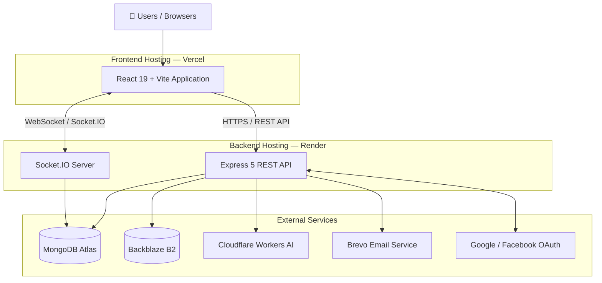

# 🚀 Deployment Guide

Production deployment documentation for **Netflix AI Watch Spaces**.

This guide describes the production hosting architecture, deployment configuration, environment variables, storage integration, and post-deployment verification process.

---

## 🌐 Production Architecture

Netflix AI Watch Spaces uses a distributed deployment architecture. The React frontend is hosted on Vercel, while the Express.js backend and Socket.IO server run on Render.

MongoDB Atlas provides database hosting, Backblaze B2 provides S3-compatible object storage, and Cloudflare Workers AI powers AI-assisted features.



## 🏗️ Production Deployment Overview

| Component               | Platform / Service      | Purpose                     |
| ----------------------- | ----------------------- | --------------------------- |
| Frontend                | Vercel                  | React application hosting   |
| Backend                 | Render                  | Express.js API hosting      |
| Real-time communication | Render + Socket.IO      | Watch Space synchronization |
| Database                | MongoDB Atlas           | Application data            |
| Object storage          | Backblaze B2            | Video and media assets      |
| AI inference            | Cloudflare Workers AI   | AI Co-Pilot and AI features |
| Email                   | Brevo                   | Transactional emails        |
| Authentication          | Google & Facebook OAuth | Social authentication       |

## 🖥️ Frontend Deployment — Vercel

The React application is deployed on Vercel.

**Production URL:**  
https://netflix-ai-watch-spaces-three.vercel.app

### Vercel Deployment Dashboard


### Frontend Build Configuration

| Setting             | Value           |
| ------------------- | --------------- |
| Framework           | Vite            |
| Root Directory      | `client`        |
| Build Command       | `npm run build` |
| Output Directory    | `dist`          |
| Development Command | `npm run dev`   |

### Vercel Environment Variables

Configure the following production environment variables in the Vercel project settings:

| Variable            | Production Value                                        |
| ------------------- | ------------------------------------------------------- |
| `VITE_API_BASE_URL` | `https://netflix-ai-watch-spaces-8zmq.onrender.com/api` |
| `VITE_SOCKET_URL`   | `https://netflix-ai-watch-spaces-8zmq.onrender.com`     |

The frontend reads these values through Vite's `import.meta.env`.

### SPA Routing Configuration

The project includes `client/vercel.json` to redirect application routes to `index.html`, allowing React Router routes to work correctly on page refresh.

```json
{
  "rewrites": [
    {
      "source": "/(.*)",
      "destination": "/index.html"
    }
  ]
}
```

## ⚙️ Backend Deployment — Render

The Express.js backend and Socket.IO server are deployed on Render.

**Backend Base URL:**  
https://netflix-ai-watch-spaces-8zmq.onrender.com

**REST API Base URL:**  
https://netflix-ai-watch-spaces-8zmq.onrender.com/api

**Socket.IO Server:**  
https://netflix-ai-watch-spaces-8zmq.onrender.com

### Render Deployment Dashboard


### Backend Runtime Configuration

| Setting         | Value                  |
| --------------- | ---------------------- |
| Runtime         | Node.js                |
| Root Directory  | `server`               |
| Entry Point     | `src/server.js`        |
| Build / Install | `npm install`          |
| Start Command   | `npm start`            |
| Port            | Render-provided `PORT` |
| Host            | `0.0.0.0`              |

The backend package defines the production start command:

```bash
npm start
```

Which executes:

```bash
node src/server.js
```

The server listens on `process.env.PORT || 5000` and binds to `0.0.0.0`.

### Backend Environment Variables

Configure production secrets and service credentials in the Render environment settings.

**Application and Database**

| Variable      | Purpose                               |
| ------------- | ------------------------------------- |
| `NODE_ENV`    | Set to `production`                   |
| `CLIENT_URL`  | Exact deployed Vercel frontend origin |
| `PORT`        | Provided by Render                    |
| `MONGODB_URI` | MongoDB Atlas connection string       |

**Authentication and OAuth**

| Variable                | Purpose                            |
| ----------------------- | ---------------------------------- |
| `ACCESS_TOKEN_SECRET`   | Access token signing secret        |
| `REFRESH_TOKEN_SECRET`  | Refresh token signing secret       |
| `GOOGLE_CLIENT_ID`      | Google OAuth client ID             |
| `GOOGLE_CLIENT_SECRET`  | Google OAuth client secret         |
| `GOOGLE_CALLBACK_URL`   | Production Google OAuth callback   |
| `FACEBOOK_APP_ID`       | Facebook application ID            |
| `FACEBOOK_APP_SECRET`   | Facebook application secret        |
| `FACEBOOK_CALLBACK_URL` | Production Facebook OAuth callback |

**Backblaze B2 Object Storage**

| Variable                | Purpose                          |
| ----------------------- | -------------------------------- |
| `B2_ENDPOINT`           | Backblaze S3-compatible endpoint |
| `B2_REGION`             | B2 bucket region                 |
| `B2_BUCKET_NAME`        | Object storage bucket name       |
| `B2_APPLICATION_KEY_ID` | B2 application key ID            |
| `B2_APPLICATION_KEY`    | B2 application key secret        |

**AI and Email Services**

| Variable                           | Purpose                         |
| ---------------------------------- | ------------------------------- |
| `CLOUDFLARE_ACCOUNT_ID`            | Cloudflare account identifier   |
| `CLOUDFLARE_API_TOKEN`             | Cloudflare API token            |
| `CLOUDFLARE_AI_MODEL`              | Workers AI model identifier     |
| `CLOUDFLARE_AI_TIMEOUT_MS`         | AI request timeout              |
| `CLOUDFLARE_AI_GENERAL_MAX_TOKENS` | General AI response token limit |
| `BREVO_API_KEY`                    | Brevo API key                   |
| `BREVO_SENDER_EMAIL`               | Verified sender email           |
| `BREVO_SENDER_NAME`                | Sender display name             |

> **Security:** Never commit production environment values, API tokens, OAuth secrets, database credentials, or storage keys to GitHub. Configure them through the hosting providers' environment settings.

## 🗄️ Database — MongoDB Atlas

MongoDB Atlas hosts the application's persistent database.

The backend connects using:

```env
MONGODB_URI=your_mongodb_atlas_connection_string
```

Before deployment, ensure:

- The production database exists.
- The database user has the required permissions.
- Network access allows the deployed backend to connect.
- The production connection string is configured in Render.

## 📦 Object Storage — Backblaze B2

Backblaze B2 is used as the S3-compatible object storage provider.

The backend uses AWS SDK for JavaScript v3 to communicate with the B2 S3-compatible API.

```env
B2_ENDPOINT=https://s3.us-east-005.backblazeb2.com
B2_REGION=us-east-005
B2_BUCKET_NAME=netflix-ai-video
B2_APPLICATION_KEY_ID=your_application_key_id
B2_APPLICATION_KEY=your_application_key
```

The backend checks bucket availability during startup.

> Note: Some existing source filenames and function names still contain the legacy `MinIO` naming. The active storage configuration shown in the backend uses the `B2_*` environment variables and the S3-compatible Backblaze B2 endpoint.

## 🔌 REST API & Socket.IO Connectivity

The frontend communicates with the backend through two separate connections.

**REST API**

```text
https://netflix-ai-watch-spaces-8zmq.onrender.com/api
```

**Socket.IO**

```text
https://netflix-ai-watch-spaces-8zmq.onrender.com
```

The Axios client uses `VITE_API_BASE_URL` and enables credentialed requests with `withCredentials: true`.

The Socket.IO client uses the configured frontend socket URL.

### CORS Configuration

The backend allows:

- Local development origin: `http://localhost:5173`
- Production origin: the value configured in `CLIENT_URL`

Credentialed requests are enabled. Make sure `CLIENT_URL` exactly matches the deployed Vercel origin.

## ❤️ Production Health Check

Use the following endpoint to verify backend and database availability:

**Health Check URL**

https://netflix-ai-watch-spaces-8zmq.onrender.com/api/health

Example healthy response:

```json
{
  "success": true,
  "message": "Netflix AI Watch Spaces API health status",
  "services": {
    "api": "running",
    "database": "connected"
  },
  "timestamp": "ISO-8601 timestamp"
}
```

The health endpoint returns HTTP `200` when MongoDB is connected and HTTP `503` otherwise.

## ✅ Post-Deployment Verification

After deploying both frontend and backend, verify the following:

### Frontend

- [ ] Production website loads successfully.
- [ ] React Router routes work after refresh.
- [ ] API requests reach the production backend.
- [ ] Authentication flows work correctly.

### Backend

- [ ] Render service starts successfully.
- [ ] MongoDB Atlas connection succeeds.
- [ ] Health check returns HTTP `200`.
- [ ] REST API endpoints respond correctly.
- [ ] CORS accepts the production frontend origin.

### Real-Time Features

- [ ] Socket.IO connection succeeds.
- [ ] Users can join Watch Spaces.
- [ ] Host-controlled playback synchronization works.
- [ ] Participant presence and live chat work.
- [ ] Voting and timeline interactions work.

### External Integrations

- [ ] Backblaze B2 bucket connectivity works.
- [ ] Media upload and retrieval work.
- [ ] Cloudflare Workers AI requests work.
- [ ] Brevo email delivery works.
- [ ] Google and Facebook OAuth callbacks use production URLs.

## 🔐 Production Security Checklist

- Keep `.env` and production credentials outside Git.
- Use HTTPS for production frontend and backend communication.
- Restrict database and storage credentials to the required permissions.
- Configure OAuth callback URLs for production.
- Keep CORS restricted to trusted frontend origins.
- Avoid exposing private object-storage credentials in frontend code.
- Review logs and service health after deployment.

---

## 🔗 Production Links

| Resource     | URL                                                          |
| ------------ | ------------------------------------------------------------ |
| Frontend     | https://netflix-ai-watch-spaces-three.vercel.app             |
| Backend      | https://netflix-ai-watch-spaces-8zmq.onrender.com            |
| REST API     | https://netflix-ai-watch-spaces-8zmq.onrender.com/api        |
| Health Check | https://netflix-ai-watch-spaces-8zmq.onrender.com/api/health |

---

**Deployment Stack:** Vercel · Render · MongoDB Atlas · Backblaze B2 · Cloudflare Workers AI
