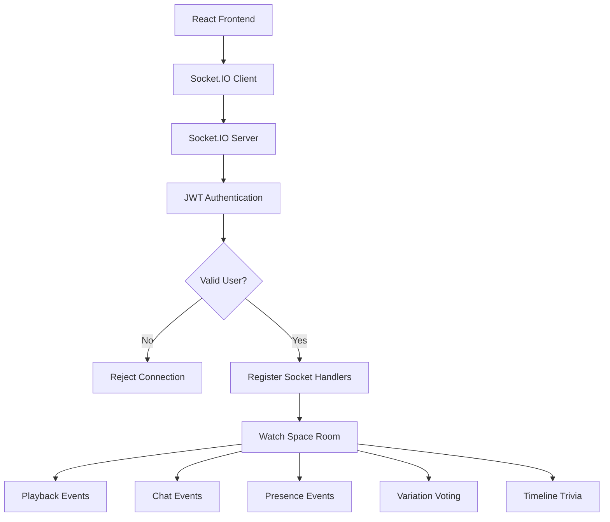
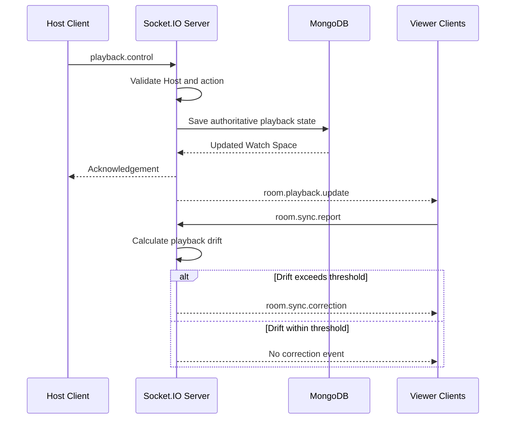

# 🔌 Socket.IO Events — API Reference

<p align="center">
  
  
  
  
</p>

This document describes the real-time communication contract used by **Netflix AI Watch Spaces**.

The application uses Socket.IO for authenticated Watch Space connections, synchronized playback, chat, participant presence, timeline trivia and collaborative narrative voting.

---

## 📑 Table of Contents

1. [Overview](#-overview)
2. [Connection Architecture](#-connection-architecture)
3. [Authentication](#-authentication)
4. [Room Management](#-room-management)
5. [Playback Synchronization](#-playback-synchronization)
6. [Chat Events](#-chat-events)
7. [Presence Events](#-presence-events)
8. [Narrative Variation Voting](#-narrative-variation-voting)
9. [Timeline Trivia](#-timeline-trivia)
10. [Acknowledgement Pattern](#-acknowledgement-pattern)
11. [Authorization and Validation](#-authorization-and-validation)
12. [Playback Synchronization Flow](#-playback-synchronization-flow)
13. [Error Handling](#-error-handling)
14. [Implementation Notes](#-implementation-notes)

---

## 🔌 Overview

Socket.IO runs on the same HTTP server as the Express backend.

It provides bidirectional communication between authenticated users inside a Watch Space.

### Communication Capabilities

| Capability      | Description                                      |
| --------------- | ------------------------------------------------ |
| Authentication  | JWT-based socket authentication                  |
| Room Management | Join and leave Watch Space rooms                 |
| Playback        | Host-controlled playback synchronization         |
| Chat            | Real-time messaging and reactions                |
| Presence        | Connected participant tracking                   |
| Trivia          | Timeline-triggered trivia notifications          |
| Voting          | Manual and automatic narrative voting            |
| Synchronization | Playback position reporting and drift correction |

### Main Socket Modules

```text
📁 server/
└── 📁 src/
    └── 📁 sockets/
        ├── 📄 index.js
        ├── 📄 room.socket.js
        ├── 📄 playback.socket.js
        ├── 📄 chat.socket.js
        ├── 📄 presence.socket.js
        └── 📄 variation.socket.js
```

| File                  | Responsibility                              |
| --------------------- | ------------------------------------------- |
| `index.js`            | Socket.IO initialization and authentication |
| `room.socket.js`      | Room join and leave                         |
| `playback.socket.js`  | Playback control and synchronization        |
| `chat.socket.js`      | Messaging, editing, deletion and reactions  |
| `presence.socket.js`  | Online participant tracking                 |
| `variation.socket.js` | Narrative voting lifecycle                  |

---

## 🏗️ Connection Architecture



### Server Initialization

The backend initializes Socket.IO in:

`server/src/sockets/index.js`

Socket.IO is attached to the HTTP server created by:

`server/src/server.js`

### Connection Configuration

The server currently initializes Socket.IO with:

```javascript
const io = new Server(httpServer, {
  cors: {
    origin: "*",
  },
});
```

---

## 🔐 Authentication

Socket connections require a valid access token.

The client sends the token through the Socket.IO handshake authentication object.

### Client Connection Example

```javascript
import { io } from "socket.io-client";

const socket = io(import.meta.env.VITE_SOCKET_URL, {
  auth: {
    token: accessToken,
  },
});
```

### Authentication Process

1. Client initiates a Socket.IO connection.
2. Client sends its access token.
3. Server verifies the JWT using `ACCESS_TOKEN_SECRET`.
4. Server retrieves the corresponding user.
5. Admin accounts are rejected.
6. Authenticated Viewer and Host connections are accepted.
7. Socket event handlers are registered.

### Authentication Rules

| Condition                | Result              |
| ------------------------ | ------------------- |
| Missing token            | Connection rejected |
| Invalid or expired token | Connection rejected |
| User no longer exists    | Connection rejected |
| Admin account            | Connection rejected |
| Valid Viewer             | Connection accepted |
| Valid Host               | Connection accepted |

The authenticated user is attached to the socket.

```javascript
socket.user = user;
socket.data.userId = user._id.toString();
```

**Important:** Event handlers derive the user's identity from the authenticated socket. Clients must not be trusted to provide their own user ID.

---

## 🚪 Room Management

Every Watch Space uses a dedicated Socket.IO room.

### Room Naming Convention

```text
watchspace:<watchSpaceId>
```

Example:

```text
watchspace:674abc1234567890abcdef12
```

### Room Events

| Direction       | Event        | Description                                       |
| --------------- | ------------ | ------------------------------------------------- |
| Client → Server | `room.join`  | Join a Watch Space room                           |
| Client → Server | `room.leave` | Leave a Socket.IO room                            |
| Server → Client | `room.error` | Room operation error when no callback is supplied |

### `room.join`

Joins an authenticated participant to a Watch Space room.

**Payload**

```javascript
{
  watchSpaceId: "WATCH_SPACE_ID";
}
```

**Acknowledgement**

```javascript
{
  success: true,
  message: "Joined WatchSpace room successfully",
  watchSpaceId: "WATCH_SPACE_ID",
  userId: "USER_ID",
  role: "host",
  playbackMode: "manual",
  playback: {
    state: "paused",
    positionSeconds: 0,
    updatedAt: null
  },
  activeVote: null
}
```

The actual `role`, playback state, position, timestamps and active vote depend on the database record.

### `room.leave`

Leaves the Socket.IO room.

**Payload**

```javascript
{
  watchSpaceId: "WATCH_SPACE_ID";
}
```

**Acknowledgement**

```javascript
{
  success: true,
  message: "Left WatchSpace room successfully",
  watchSpaceId: "WATCH_SPACE_ID"
}
```

> Leaving a Socket.IO room does not remove the user's persisted Watch Space participation.

### Room Access Rules

- Watch Space ID must be valid.
- Watch Space must exist.
- Ended Watch Spaces cannot be joined.
- User must already be a persisted participant.
- Room membership is required for room-scoped operations.

---

## 🎥 Playback Synchronization

Playback synchronization is implemented in:

`server/src/sockets/playback.socket.js`

The Host controls the authoritative playback state. Viewers report their playback positions, and the server calculates drift and sends correction instructions when necessary.

### Playback Events

| Direction       | Event                        | Description                      |
| --------------- | ---------------------------- | -------------------------------- |
| Client → Server | `playback.control`           | Host playback control            |
| Client → Server | `room.playback.mode.update`  | Update playback mode             |
| Client → Server | `room.sync.ping`             | Request synchronization ping     |
| Client → Server | `room.sync.report`           | Report local playback position   |
| Server → Client | `room.playback.update`       | Broadcast playback state         |
| Server → Client | `room.playback.mode.changed` | Broadcast playback mode change   |
| Server → Client | `room.sync.pong`             | Return synchronization timestamp |
| Server → Client | `room.playback.position`     | Broadcast authoritative position |
| Server → Client | `room.sync.correction`       | Send Viewer drift correction     |

### `playback.control`

Used by the Host to control Watch Space playback.

**Payload**

```javascript
{
  watchSpaceId: "WATCH_SPACE_ID",
  action: "play",
  positionSeconds: 120
}
```

Supported actions:

| Action      | Behaviour                                                               |
| ----------- | ----------------------------------------------------------------------- |
| `play`      | Start playback                                                          |
| `pause`     | Pause playback                                                          |
| `seek`      | Update playback position while preserving the existing play/pause state |
| `buffering` | Set playback state to buffering                                         |

**Success acknowledgement**

```javascript
{
  success: true,
  message: "Playback updated successfully",
  event: "room.playback.update",
  watchSpaceId: "WATCH_SPACE_ID",
  payload: {
    state: "play",
    positionSeconds: 120,
    issuedBy: "HOST_USER_ID"
  },
  ts: 1730000000000
}
```

**Server broadcast**

`room.playback.update`

```javascript
{
  event: "room.playback.update",
  watchSpaceId: "WATCH_SPACE_ID",
  payload: {
    state: "play",
    positionSeconds: 120,
    issuedBy: "HOST_USER_ID"
  },
  ts: 1730000000000
}
```

### Host Authority

Only the Watch Space Host can issue `playback.control`.

The backend validates:

- Valid Watch Space ID.
- Allowed playback action.
- Current socket room membership.
- Watch Space existence and status.
- Host ownership.
- Valid title duration.
- Playback position within the title duration.

### `room.playback.mode.update`

Allows the Host to change the playback mode.

**Payload**

```javascript
{
  watchSpaceId: "WATCH_SPACE_ID",
  mode: "automatic"
}
```

Supported modes:

- `manual`
- `automatic`

**Success acknowledgement**

```javascript
{
  success: true,
  playbackMode: "automatic"
}
```

**Broadcast event**

`room.playback.mode.changed`

```javascript
{
  watchSpaceId: "WATCH_SPACE_ID",
  mode: "automatic",
  updatedBy: "HOST_USER_ID"
}
```

The server prevents mode changes while an active vote is open or closed but not yet applied.

### `room.sync.ping`

Requests a server synchronization timestamp.

**Payload**

```javascript
{
  watchSpaceId: "WATCH_SPACE_ID",
  clientSentAt: Date.now()
}
```

**Server response event**

`room.sync.pong`

```javascript
{
  event: "room.sync.pong",
  watchSpaceId: "WATCH_SPACE_ID",
  payload: {
    clientSentAt: 1730000000000,
    serverReceivedAt: 1730000000020
  },
  ts: 1730000000020
}
```

The server also returns an acknowledgement when a callback is provided.

### `room.sync.report`

Reports a client's playback position to the backend.

**Payload**

```javascript
{
  watchSpaceId: "WATCH_SPACE_ID",
  positionSeconds: 125
}
```

**Acknowledgement**

```javascript
{
  success: true,
  message: "Playback position received",
  watchSpaceId: "WATCH_SPACE_ID",
  userId: "USER_ID",
  role: "viewer",
  positionSeconds: 125,
  receivedAt: 1730000000000,
  estimatedHostPosition: 125.2
}
```

The estimated Host position can be `null` when no sufficiently recent Host position is available.

### `room.playback.position`

Broadcasts the Host's authoritative playback position to the room.

```javascript
{
  watchSpaceId: "WATCH_SPACE_ID",
  positionSeconds: 125,
  updatedAt: 1730000000000
}
```

### `room.sync.correction`

Sent to a Viewer when the calculated playback drift exceeds the configured threshold.

```javascript
{
  event: "room.sync.correction",
  watchSpaceId: "WATCH_SPACE_ID",
  payload: {
    targetPositionSeconds: 125.5,
    driftSeconds: 0.5,
    issuedBy: "HOST_USER_ID"
  },
  ts: 1730000000000
}
```

The client should use `targetPositionSeconds` as the synchronization target.

### Playback Synchronization Constants

| Constant                       |        Value | Purpose                                      |
| ------------------------------ | -----------: | -------------------------------------------- |
| `DRIFT_THRESHOLD_SECONDS`      | 0.25 seconds | Viewer correction threshold                  |
| `HOST_POSITION_MAX_AGE_MS`     |      2000 ms | Maximum age for estimating Host position     |
| `PROGRESS_PERSIST_INTERVAL_MS` |     15000 ms | Playback progress persistence interval       |
| `PROGRESS_RETRY_INTERVAL_MS`   |      5000 ms | Progress save retry interval                 |
| `MAX_REPORT_INTERVAL_SECONDS`  |    5 seconds | Accepted reporting interval                  |
| `MAX_POSITION_DRIFT_SECONDS`   |  1.5 seconds | Plausibility threshold for progress tracking |
| `MAX_PENDING_PROGRESS_SECONDS` |   30 seconds | Pending progress cap                         |

These are implementation constants, not measured end-to-end performance results.

### Host Disconnect Behaviour

When the Host disconnects:

1. The backend checks whether another Host socket is still connected.
2. If another Host connection exists, playback is not paused by that disconnect.
3. Otherwise, the backend preserves the latest known Host position when available.
4. Playback state is changed to `paused`.
5. Remaining participants receive `room.playback.update` with the reason `host_disconnected`.

---

## 💬 Chat Events

Chat functionality is implemented in:

`server/src/sockets/chat.socket.js`

### Chat Event Reference

| Direction       | Event                   | Description                        |
| --------------- | ----------------------- | ---------------------------------- |
| Client → Server | `chat.message.send`     | Send a message                     |
| Client → Server | `chat.message.edit`     | Edit own message                   |
| Client → Server | `chat.message.delete`   | Delete own message                 |
| Client → Server | `chat.history.get`      | Retrieve recent messages           |
| Client → Server | `chat.typing`           | Update typing status               |
| Client → Server | `chat.reaction.add`     | Add or toggle emoji reaction       |
| Server → Client | `chat.message.new`      | New message broadcast              |
| Server → Client | `chat.message.updated`  | Updated message broadcast          |
| Server → Client | `chat.message.deleted`  | Deleted message broadcast          |
| Server → Client | `chat.typing.update`    | Typing status broadcast            |
| Server → Client | `chat.reaction.updated` | Updated reaction/message broadcast |

### `chat.message.send`

**Payload**

```javascript
{
  watchSpaceId: "WATCH_SPACE_ID",
  message: "Hello everyone!"
}
```

**Broadcast**

`chat.message.new`

```javascript
{
  event: "chat.message.new",
  watchSpaceId: "WATCH_SPACE_ID",
  payload: {
    // Populated ChatMessage document
  },
  ts: 1730000000000
}
```

The saved message includes the populated sender information.

### `chat.message.edit`

**Payload**

```javascript
{
  watchSpaceId: "WATCH_SPACE_ID",
  messageId: "MESSAGE_ID",
  message: "Updated message"
}
```

Only the original sender can edit a message.

**Broadcast**

`chat.message.updated`

### `chat.message.delete`

**Payload**

```javascript
{
  watchSpaceId: "WATCH_SPACE_ID",
  messageId: "MESSAGE_ID"
}
```

Only the original sender can delete a message.

**Broadcast**

`chat.message.deleted`

```javascript
{
  event: "chat.message.deleted",
  watchSpaceId: "WATCH_SPACE_ID",
  payload: {
    messageId: "MESSAGE_ID",
    deletedBy: "USER_ID"
  },
  ts: 1730000000000
}
```

### `chat.history.get`

**Payload**

```javascript
{
  watchSpaceId: "WATCH_SPACE_ID",
  limit: 50
}
```

The server limits the requested history size to a maximum of 100 messages.

**Acknowledgement**

```javascript
{
  success: true,
  messages: [
    // Recent messages, ordered oldest to newest
  ]
}
```

### `chat.typing`

**Payload**

```javascript
{
  watchSpaceId: "WATCH_SPACE_ID",
  isTyping: true
}
```

**Broadcast**

`chat.typing.update`

```javascript
{
  watchSpaceId: "WATCH_SPACE_ID",
  user: {
    _id: "USER_ID",
    name: "User Name"
  },
  isTyping: true
}
```

Typing updates are sent to the other room participants.

### `chat.reaction.add`

Adds or removes the authenticated user's selected emoji reaction.

**Payload**

```javascript
{
  watchSpaceId: "WATCH_SPACE_ID",
  messageId: "MESSAGE_ID",
  emoji: "❤️"
}
```

**Broadcast**

`chat.reaction.updated`

```javascript
{
  event: "chat.reaction.updated",
  watchSpaceId: "WATCH_SPACE_ID",
  payload: {
    // Updated populated ChatMessage document
  },
  ts: 1730000000000
}
```

The same event is used when an existing reaction is toggled off.

### Chat Validation

- Message cannot be empty.
- Maximum message length: 2000 characters.
- User must be a persisted Watch Space participant.
- User must have joined the Socket.IO room.
- Only the original sender can edit or delete their message.
- Reaction emoji must be a non-empty string of at most 32 characters.

---

## 👥 Presence Events

Presence functionality is implemented in:

`server/src/sockets/presence.socket.js`

### Presence Event Reference

| Direction       | Event              | Description                            |
| --------------- | ------------------ | -------------------------------------- |
| Client → Server | `presence.get`     | Request current online participants    |
| Client → Server | `presence.join`    | Register presence after joining        |
| Server → Client | `presence.updated` | Broadcast current participant presence |

### `presence.get`

**Payload**

```javascript
{
  watchSpaceId: "WATCH_SPACE_ID";
}
```

**Acknowledgement**

```javascript
{
  success: true,
  watchSpaceId: "WATCH_SPACE_ID",
  participants: [
    {
      user: {
        _id: "USER_ID",
        name: "User Name",
        avatar: "AVATAR_VALUE"
      },
      role: "viewer",
      isOnline: true
    }
  ]
}
```

### `presence.join`

Called after a successful room join to register and broadcast the participant's presence.

**Payload**

```javascript
{
  watchSpaceId: "WATCH_SPACE_ID";
}
```

**Acknowledgement**

```javascript
{
  success: true;
}
```

### `presence.updated`

Broadcast to the Watch Space room.

```javascript
{
  watchSpaceId: "WATCH_SPACE_ID",
  participants: [
    // Currently connected persisted participants
  ],
  ts: 1730000000000
}
```

The server also updates the Watch Space's `peakParticipants` value when broadcasting presence.

When a socket disconnects, the server broadcasts the updated online participant list for rooms tracked by that socket.

---

## 🗳️ Narrative Variation Voting

Voting functionality is implemented in:

`server/src/sockets/variation.socket.js`

The application supports:

- Manual Host-initiated voting.
- Automatic timeline-triggered voting.
- Participant vote submission.
- Live vote count updates.
- Winner announcement.
- Timeline-based variation application.
- Vote state retrieval after reconnection.

### Variation Event Reference

| Direction       | Event                       | Description                             |
| --------------- | --------------------------- | --------------------------------------- |
| Client → Server | `variation.vote.state.get`  | Retrieve active vote and playback state |
| Client → Server | `variation.vote.start`      | Host starts manual voting               |
| Client → Server | `variation.vote.cast`       | Participant submits or changes vote     |
| Server → Client | `room.variation.voteOpen`   | Vote opened                             |
| Server → Client | `room.variation.voteUpdate` | Vote counts updated                     |
| Server → Client | `room.variation.voteResult` | Voting result announced                 |
| Server → Client | `room.variation.applied`    | Winning variation applied               |

### `variation.vote.state.get`

Used after room join or reconnection to retrieve the latest persisted vote state.

**Payload**

```javascript
{
  watchSpaceId: "WATCH_SPACE_ID";
}
```

**Acknowledgement**

```javascript
{
  success: true,
  activeVote: null,
  playback: {
    // Current persisted playback state
  }
}
```

`activeVote` contains the current vote object or `null`.

### `variation.vote.start`

Starts a manual narrative vote.

Only the Host can start a manual vote.

**Payload**

```javascript
{
  watchSpaceId: "WATCH_SPACE_ID",
  variationId: "VARIATION_ID",
  durationSeconds: 30
}
```

The default duration is 30 seconds.

Allowed manual duration:

- Minimum: 5 seconds.
- Maximum: 120 seconds.

The variation must exist in the Title's pre-authored timeline and contain at least two options.

**Broadcast**

`room.variation.voteOpen`

```javascript
{
  watchSpaceId: "WATCH_SPACE_ID",
  variationId: "VARIATION_ID",
  question: "Which path should the story follow?",
  options: [
    {
      id: "option-a",
      label: "Option A"
    },
    {
      id: "option-b",
      label: "Option B"
    }
  ],
  closesAt: "VOTE_CLOSE_TIMESTAMP",
  durationSeconds: 30,
  mode: "manual"
}
```

### `variation.vote.cast`

A participant submits a vote or changes their previous vote.

**Payload**

```javascript
{
  watchSpaceId: "WATCH_SPACE_ID",
  optionId: "option-a"
}
```

One vote per participant is maintained. A new submission replaces that participant's previous selected option.

**Broadcast**

`room.variation.voteUpdate`

```javascript
{
  variationId: "VARIATION_ID",
  voteCount: 3,
  voteCounts: {
    "option-a": 2,
    "option-b": 1
  },
  isNewVote: true,
  updatedOptionId: "option-a"
}
```

### `room.variation.voteResult`

Emitted when the voting period closes.

```javascript
{
  watchSpaceId: "WATCH_SPACE_ID",
  variationId: "VARIATION_ID",
  voteCounts: {
    "option-a": 2,
    "option-b": 1
  },
  winningOptionId: "option-a",
  applyAtSeconds: 240,
  mode: "manual"
}
```

### `room.variation.applied`

Emitted when the winning variation reaches its configured application point.

```javascript
{
  watchSpaceId: "WATCH_SPACE_ID",
  variationId: "VARIATION_ID",
  winningOptionId: "option-a",
  applyAtSeconds: 240,
  appliedAt: "APPLICATION_TIMESTAMP"
}
```

### Automatic Voting

Automatic voting is triggered by the server when the Host's playback position crosses a configured `variationPoint` timeline marker.

Conditions include:

- Watch Space is active.
- Playback is running.
- Playback mode is `automatic`.
- Voting is enabled.
- No unfinished vote is blocking another vote.
- The timeline variation point has at least two options.
- The event has not already been triggered.

**Automatic vote duration: 60 seconds.**

The server emits:

`room.variation.voteOpen`

The payload contains:

```javascript
{
  watchSpaceId: "WATCH_SPACE_ID",
  variationId: "VARIATION_ID",
  question: "Timeline question",
  eventId: "TIMELINE_EVENT_ID",
  options: [],
  closesAt: "VOTE_CLOSE_TIMESTAMP",
  durationSeconds: 60,
  mode: "automatic"
}
```

After voting closes, the winning variation is associated with the persisted playback position and applied when the application point is reached.

The server also checks for expired automatic votes during subsequent Host playback reports, allowing recovery after a process restart.

---

## 🧠 Timeline Trivia

Timeline trivia is triggered by playback position changes in:

`server/src/sockets/playback.socket.js`

### Event

| Direction       | Event            | Description                         |
| --------------- | ---------------- | ----------------------------------- |
| Server → Client | `room.ai.trivia` | Timeline trivia marker notification |

### `room.ai.trivia`

Emitted when playback crosses an eligible trivia timeline event.

**Payload**

```javascript
{
  watchSpaceId: "WATCH_SPACE_ID",
  eventId: "TRIVIA_EVENT_ID",
  eventType: "trivia",
  startTime: 120,
  endTime: 150,
  text: "Trivia question or information",
  triggeredAt: 1730000000000
}
```

### Trigger Conditions

- Trivia must be enabled for the Watch Space.
- The Watch Space must not have ended.
- Timeline event must have `eventType: "trivia"`.
- Event must have a valid start and end time.
- Event must have a valid `eventId`.
- Event must contain usable text or description.
- Playback must cross the configured timeline marker.

Triggered trivia event IDs are persisted on the Watch Space to prevent duplicate triggering.

---

## ✅ Acknowledgement Pattern

Many client-to-server events support Socket.IO acknowledgement callbacks.

### Example

```javascript
socket.emit(
  "room.join",
  {
    watchSpaceId,
  },
  (response) => {
    if (!response.success) {
      console.error(response.message);
      return;
    }

    console.log("Joined:", response);
  },
);
```

### Standard Success Response

```javascript
{
  success: true;
}
```

### Standard Error Response

```javascript
{
  success: false,
  message: "Error description"
}
```

Not every event uses a callback. For example, `chat.typing` is fire-and-forget and sends its update through a server broadcast.

Always check the individual event implementation before assuming that an acknowledgement is available.

---

## 🛡️ Authorization and Validation

The backend validates socket access at multiple levels.

| Operation             | Authorization                             |
| --------------------- | ----------------------------------------- |
| Socket connection     | Valid JWT and non-admin user              |
| Room join             | Persisted Watch Space participant         |
| Playback control      | Host only                                 |
| Playback mode update  | Host only                                 |
| Manual vote start     | Host only                                 |
| Vote submission       | Watch Space participant                   |
| Chat send             | Persisted participant and room membership |
| Chat edit             | Original message sender                   |
| Chat delete           | Original message sender                   |
| Presence request      | Joined room participant                   |
| Trivia                | Server-triggered                          |
| Variation application | Server-controlled                         |

### Important Security Rules

1. Never trust a client-provided user ID.
2. Derive user identity from the authenticated socket.
3. Validate Watch Space IDs.
4. Validate playback positions against title duration.
5. Verify Host ownership before accepting playback controls.
6. Verify room membership before room-scoped operations.
7. Verify participant membership before voting.
8. Do not expose access tokens in event payloads or logs.

---

## 🔄 Playback Synchronization Flow



The Host's playback state is authoritative. Viewer reports are used for synchronization and individual playback progress tracking; they do not grant viewers permission to control the Watch Space.

---

## ⚠️ Error Handling

The backend returns error acknowledgements when callbacks are supplied.

Examples of possible errors include:

| Error                                         | Cause                                 |
| --------------------------------------------- | ------------------------------------- |
| Authentication required                       | Missing socket token                  |
| Invalid or expired access token               | JWT verification failed               |
| WatchSpace not found                          | Invalid or missing room               |
| You must join this WatchSpace                 | User is not a persisted participant   |
| Only the WatchSpace host can control playback | Viewer attempted Host-only control    |
| Invalid playback position                     | Position outside title duration       |
| Voting is disabled                            | Voting disabled for the room          |
| There is no active vote                       | No open vote exists                   |
| Invalid voting option                         | Option does not belong to active vote |

When no callback is supplied, some room and playback handlers emit `room.error`. Other handlers log errors or return without broadcasting an error event.

Clients should use acknowledgements wherever supported.

---

## 📝 Implementation Notes

### Server-Side State

The current implementation uses in-memory Maps for some runtime state, including:

- Host playback positions.
- Triggered trivia tracking.
- Progress trackers.
- Automatic vote timers.

Persisted Watch Space data is also used for playback state, vote state and triggered event identifiers.

In-memory state is process-local and should not be treated as shared state across multiple backend instances.

### Important Constants

| Setting                   | Implementation    |
| ------------------------- | ----------------- |
| Playback drift threshold  | 0.25 seconds      |
| Host position freshness   | 2000 milliseconds |
| Automatic voting duration | 60 seconds        |
| Manual vote duration      | 5–120 seconds     |
| Chat message length       | 2000 characters   |
| Chat history maximum      | 100 messages      |

### Source Files

For implementation-level payload details, refer to:

- `server/src/sockets/index.js`
- `server/src/sockets/room.socket.js`
- `server/src/sockets/playback.socket.js`
- `server/src/sockets/chat.socket.js`
- `server/src/sockets/presence.socket.js`
- `server/src/sockets/variation.socket.js`

---

<p align="center">
  <strong>Netflix AI Watch Spaces</strong><br/>
  Real-time collaboration powered by Socket.IO.
</p>
